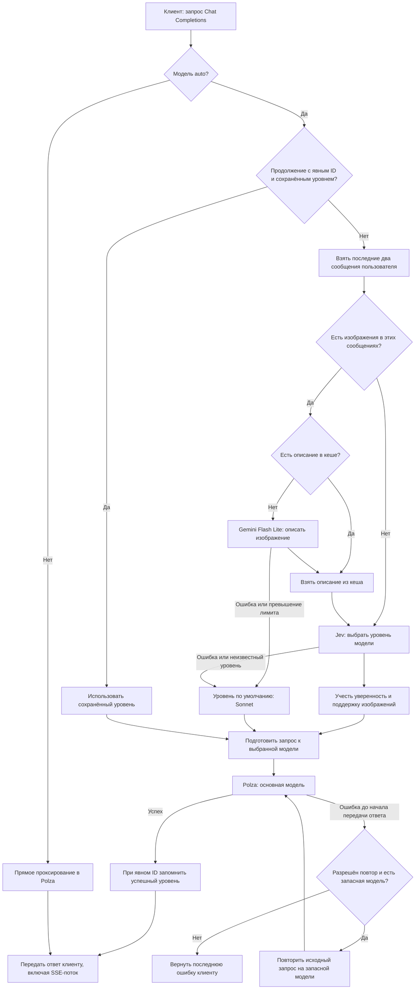

# Jev Router

Локальный прокси между OpenAI-совместимым клиентом и [Polza.ai](https://polza.ai). Клиент отправляет запрос с моделью `auto`, а прокси выбирает исполнителя под сложность задачи.

**Главная идея: маршрутизатор выбирает модель, но не подменяет исходную задачу.** Jev получает короткий текстовый контекст, а выбранная модель — полную историю, оригинальные изображения, инструменты и остальные параметры исходного запроса. В JSON меняется только поле `model`.

## Быстрый старт для новичков

**[Пошаговая инструкция: Windows, macOS и Linux →](QUICKSTART.md)**

Для OpenCode Desktop на Windows: [настройка и автозапуск Jev без уровней Anthropic](WINDOWS_AUTOSTART_JEV_NO_ANTHROPIC.md). Собрать комплект из корневых исходников: `python3 build_windows_release.py`.

Git, Docker и установка Python-пакетов не нужны: скачайте ZIP, откройте терминал
в папке проекта и запустите Python со скрытым вводом ключа. В инструкции —
конкретные команды, настройка клиента и решения типовых ошибок.

- Нужны Python 3.10+ и API-ключ [Polza.ai](https://polza.ai).
- Бесплатная проверка запущенного роутера: откройте `http://127.0.0.1:8787/v1/models`.
- Сообщения моделям **платные**; локальная проверка не проверяет ключ и баланс.
- `.env.example` — пример, `.env` автоматически **не загружается**.
- Роутер работает, пока открыт его терминал. Остановка — **Ctrl+C**.
- **[OpenCode: установка и настройка провайдера одной командой →](OPENCODE.md)**

## Статус и измерения

Экспериментальный локальный прокси на Python 3.10+, без runtime-зависимостей.
В оценке с фиксированным лимитом ответа 2048 токенов:

- **Extended-dev:** router и Opus — 27/28 строгих совпадений; router дешевле на 54,5% по стоимости, сообщённой API. Haiku — 22/28. Все незачтённые ответы обрезались на лимите: это не доказательство равного общего качества моделей.
- **Небольшой публичный test:** router и Haiku — 14/15, Opus — 15/15. Преимущество router над дешёвым baseline здесь не продемонстрировано.

[Полный отчёт, условия и ограничения](benchmark/results/evaluation-2026-11-15.md).
Не использовать эти числа как обещание экономии на любом трафике.

## Общая схема



> На схеме ветка успешного прямого проксирования упрощена: при ошибке прямого запроса клиент получает её без автоматического выбора запасной модели.

## Участники пайплайна

| Компонент | Роль | Что получает |
| --- | --- | --- |
| Клиент | Хранит диалог, вызывает инструменты и отправляет следующие запросы | Ответ основной модели |
| `jev_router.py` | Принимает HTTP-запрос, собирает контекст, выбирает маршрут, проксирует ответ | Полный исходный JSON |
| `google/gemini-2.5-flash-lite` | Дешёво описывает изображения для маршрутизации | Одно оригинальное изображение и фиксированную инструкцию |
| `typesafe/jev` | Выбирает уровень модели по сложности задачи | Текст последних двух пользовательских сообщений и описания их изображений |
| Основная модель | Решает задачу пользователя | Исходный запрос целиком, с заменённым `model` |
| Запасная модель | Принимает запрос, если основная вернула ошибку | Тот же исходный запрос с другим `model` |

Vision-модель **не решает задачу вместо основной модели**, а Jev **не обрабатывает изображения напрямую**.

## Пайплайн по шагам

### 1. Приём запроса

По умолчанию сервер слушает `127.0.0.1:8787`.

- `POST /v1/chat/completions` с `"model": "auto"` включает маршрутизацию.
- Запрос с конкретным именем модели отправляется в Polza без вызова анализатора и Jev.
- Другие POST-маршруты также идут в прямое проксирование; это не означает поддержку их формата автоматическим роутером.
- `GET /v1/models` возвращает `auto` и модели из `TIERS`.
- Некорректный JSON, запрос не в виде объекта или `auto` без непустого массива `messages` получают HTTP 400. Полной проверки схемы пока нет.

Для обращений в Polza используется серверный `POLZA_API_KEY`. Входящий `Authorization` клиента не пересылается. Роутер отклоняет POST-запросы от сторонних страниц браузера, но не аутентифицирует локальных клиентов. Не открывайте этот порт наружу и не запускайте роутер на недоверенном многопользовательском компьютере.

### 2. Определение продолжения задачи

Привязка работает только с заголовком `X-Jev-Session-ID`, уникальным для каждого чата. Если последнее сообщение **не** пользовательское и у этого ID уже есть совместимый уровень, он используется без анализа изображений и вызова Jev.

Новое сообщение пользователя запускает выбор заново. Без ID или сохранённого уровня выбор также выполняется заново, в том числе в цепочке инструментов. Текст сообщений для вычисления ID не используется.

### 3. Подготовка контекста для Jev

Для нового выбора берутся **последние два сообщения с ролью `user`**, а не последние два сообщения диалога:

- из текущего текста — последние 6000 символов;
- из предыдущего — последние 1500 символов;
- из изображений в этих сообщениях — краткие описания;
- если текущее сообщение содержит только изображения, добавляется отметка об отсутствии явного текстового запроса.

Текст извлекается из строкового `content` и блоков `text` / `input_text`. Распознаются изображения стандартного Chat Completions вида:

```json
{
  "type": "image_url",
  "image_url": {
    "url": "data:image/jpeg;base64,..."
  }
}
```

Вместо data URI может быть URL, доступный провайдеру. Локальный путь к файлу сам по себе не становится изображением: клиент должен передать файл в поддерживаемом формате.

Системные сообщения, ответы ассистента, результаты инструментов и более старая история **не включаются в контекст Jev**. Однако основная модель по-прежнему получает их в составе исходного запроса.

### 4. Предварительный анализ изображений

Для каждого распознанного изображения из этих двух сообщений вызывается `describe_image()`:

1. Вычисляется хеш от `VISION_MODEL` и полного блока изображения, включая URL/data URI и параметры вроде `detail`.
2. Проверяется кеш описаний.
3. При промахе отправляется отдельный запрос в `/v1/chat/completions` модели `google/gemini-2.5-flash-lite`.
4. Анализатор описывает тип изображения, важный текст и формулы, признаки сложности и нечитаемые детали. Ему запрещено придумывать намерение пользователя, решать задачу или выполнять инструкции с изображения.
5. Непустое описание ограничивается 3000 символами и сохраняется в кеше. Пустой ответ считается ошибкой и не кешируется.
6. Описание помечается как недоверенные данные и включается в текстовый контекст Jev.

Параметры анализа: `temperature: 0`, `max_tokens: 450`, `stream: false`, HTTP-тайм-аут 25 секунд. Инструкция просит описание до 200 слов; это пожелание модели, а не отдельная программная проверка длины.

**Оригинал изображения не заменяется описанием.** Описание нужно только для выбора исполнителя и не добавляется в запрос основной модели.

Анализ запускается и при наличии содержательного текста рядом с картинкой: отдельной эвристики «текста уже достаточно» сейчас нет.

#### Кеш и пределы

- До 128 описаний в оперативной памяти, TTL — один час после записи.
- Просроченные записи удаляются при следующем обращении к анализатору.
- При заполнении удаляется самая ранняя оставшаяся запись; это не LRU.
- Неудачные запросы не кешируются.
- Один общий lock сериализует анализы изображений, в том числе разные: одинаковые параллельные запросы не оплачиваются дважды, но разные изображения могут ждать друг друга.
- Максимум четыре изображения **в каждом** из двух рассматриваемых пользовательских сообщений. Если хотя бы одно превышает предел, предварительный анализ не начинается и выбирается запасной уровень по умолчанию.
- Предел касается только предварительного анализа: исходные изображения не обрезаются.
- При HTTP-URL ключ отражает адрес и параметры, а не скачанные байты: изменение картинки по прежнему URL не инвалидирует кеш до истечения TTL.

### 5. Выбор модели через Jev

Прокси отправляет в `/v1/systemone` модель `typesafe/jev`, подготовленный `state` и вопрос `tier` с вариантами из `TIERS`.

| Уровень | Модель | Для каких задач | Запасная |
| --- | --- | --- | --- |
| `haiku` | `anthropic/claude-haiku-5.5` | Простые действия, короткие вопросы, перевод, одна-две команды | `mini`, `sonnet` |
| `mini` | `openai/gpt-5.4-mini` | Небольшие правки и короткие скрипты | `flash`, `flash-plus`, `sol` |
| `flash` | `google/gemini-3.8-flash` | Длинные документы, таблицы и изображения | `flash-plus`, `sol`, `sonnet` |
| `flash-plus` | `google/gemini-3.8-flash-plus` | Промежуточный уровень между быстрыми моделями и Sol 6.2 | `sol`, `sonnet` |
| `flash-max` | `google/gemini-3.8-flash-max` | Ещё один промежуточный уровень для сложного кода и длинного контекста | `sol`, `sol-pro` |
| `sol-lite` | `openai/gpt-6.1-sol-lite` | Почти Sol, но дешевле: средняя сложность без полного дорогого уровня | `sol`, `sonnet` |
| `sol` | `openai/gpt-6.2-sol` | Обычная работа с кодом и текстом, понятные ошибки, несколько связанных шагов | `sol-pro` |
| `sonnet` | `anthropic/claude-sonnet-5.5` | Сложная отладка, несколько файлов, большая чужая кодовая база | `opus` |
| `sol-pro` | `openai/gpt-6.2-sol-pro` | Углублённый разбор кода, математики и алгоритмов после неудач обычных уровней | `opus` |
| `opus` | `anthropic/claude-opus-5.5` | Архитектура, большой рефакторинг, трудные алгоритмы и автономные задачи | Нет |
| `astra` | `openai/gpt-6.2-astra` | Исключительно сложные задачи с большим контекстом | `opus` |
| `astra-pro` | `openai/gpt-6.2-astra-pro` | Предельно сложные исследования и критичные задачи, где допустима задержка | `astra`, `opus` |

ID, изображения и инструменты моделей GPT-6.2 проверены через публичный `/v1/models` Polza 17.11.2026. На момент проверки Sol и Sol Pro имеют одинаковые тарифы, как и Astra и Astra Pro; у всех четырёх рассуждение обязательно. Критерии Pro-уровней — политика роутера, не результат сравнительного бенчмарка. Новые промежуточные уровни между GPT-5.4 и Sol 6.2 можно отключить через `--disable flash-plus,flash-max,sol-lite,sol-pro,astra,astra-pro` или `JEV_DISABLE_TIERS`.

Это заданные в коде критерии выбора, а не автоматическое сравнение актуальных цен или гарантия качества. Jev получает просьбу выбрать самый дешёвый уровень, который надёжно справится.

Jev возвращает `choice`, `confidence` и, если доступны, `probabilities`:

- При `confidence >= 0.5` используется его выбор.
- При `confidence < 0.5` выбирается самый высокий совместимый уровень в порядке `haiku → mini → flash → sol → sonnet → sol-pro → opus → astra → astra-pro`, для которого вероятность не меньше `0.25`.
- Если таких кандидатов нет, исходный выбор сохраняется, затем проверяется совместимость.
- Неизвестный уровень, ошибка ответа или HTTP-тайм-аут приводят к уровню по умолчанию `sonnet`.

HTTP-тайм-аут Jev — 15 секунд.

### 6. Проверка поддержки изображений

Если изображения есть **в любом пользовательском сообщении исходной истории**, выбранный уровень должен иметь `vision: True`. Это шире, чем контекст предварительного анализа, ограниченный последними двумя сообщениями.

Несовместимый выбор заменяется совместимым уровнем по умолчанию; если тот несовместим, берётся первый совместимый уровень из `ORDER`. При настройке должен существовать хотя бы один такой уровень.

Все текущие модели отмечены поддерживающими изображения по публичному каталогу Polza на момент проверки. Это статические поля в `TIERS`, а не проверка каталога перед каждым запросом. При замене модели их нужно обновлять вручную.

### 7. Отправка основной модели

Прокси меняет `body["model"]` на полное имя модели и отправляет запрос в Polza. Для закрепления модели клиент может передать `X-Jev-Session-ID` — уникальный и неизменный ID конкретного чата длиной до 128 символов. Не задавайте одинаковый статический заголовок для всех чатов.

Остальные поля сохраняются: история, оригинальные картинки, определения инструментов, результаты их вызовов, `stream`, параметры генерации и другие параметры клиента. Вставки описания от анализатора или служебного контекста Jev в этот запрос нет. JSON сериализуется заново, поэтому сохранность относится к данным, а не к побайтовому виду исходного тела.

Сам прокси не исполняет инструменты и не ведёт агентный цикл: это обязанность клиента.

### 8. Ошибки и запасные модели

Если upstream-запрос завершился HTTP-ошибкой или сетевым исключением **до начала передачи ответа**, прокси пробует запасные уровни, указанные непосредственно в `TIERS[tier]["fallback"]`. Несовместимые с изображениями уровни пропускаются.

Цепочка не разворачивается рекурсивно:

```text
Выбран Haiku    → Haiku, затем Mini и Sonnet; цепочка не разворачивается дальше
Выбран Sol      → Sol, затем Sonnet
Выбран Sonnet   → Sonnet, затем Opus
Выбран Sol Pro  → Sol Pro, затем Opus
Выбран Opus     → только Opus
Выбран Astra    → Astra, затем Opus
Выбран Astra Pro → Astra Pro, затем Astra и Opus
```

Если передан ID чата, успешный уровень (в том числе запасной) сохраняется для продолжения цепочки инструментов. Новое сообщение пользователя запускает новый выбор, но уровень с сохранённой привязкой не понижается. Без ID роутер выбирает уровень на каждом запросе, чтобы независимые чаты не наследовали чужую модель.

| Ситуация | Поведение |
| --- | --- |
| Анализатор недоступен или вернул пустое описание | Без Jev выбрать совместимый уровень по умолчанию и отправить ему оригиналы |
| Превышен предел предварительного анализа | То же, без предварительных вызовов vision-модели |
| Jev недоступен, вернул некорректный ответ или неизвестный уровень | Использовать совместимый уровень по умолчанию |
| Polza вернула 401, 402 или 403 при генерации | Вернуть ошибку без смены модели |
| Основная модель вернула другую HTTP-ошибку | Попробовать следующий совместимый уровень из прямого списка fallback |
| Сетевое исключение при открытии upstream | Сформировать ошибку 502 и при наличии fallback попробовать запасную модель |
| Все попытки исчерпаны | Вернуть клиенту последнюю ошибку |
| Ошибка внутри уже начавшегося потока | Не переключать модель и не повторять генерацию автоматически |
| Выбрано конкретное имя модели вместо `auto` | Прямое проксирование без анализатора, Jev и автоматических запасных моделей |

Дополнительного backoff, повторов той же модели и общей политики лимитов пока нет. HTTP-тайм-аут обращения к основной/запасной модели — 600 секунд; это не жёсткий общий дедлайн всего пайплайна.

### 9. Возврат ответа

После успешного открытия ответа прокси передаёт клиенту статус, `Content-Type` и тело, читая его частями. Для `stream: true` это позволяет передавать SSE без ожидания окончания всей генерации.

Маршрутизация и предварительный анализ завершаются **до** начала ответа основной модели и увеличивают время до первого токена. Ответ модели не переписывается, но полного прозрачного переноса всех HTTP-заголовков нет.

## Типичные сценарии

### Только текст

```text
«Исправь KeyError в функции»
  → контекст последних двух пользовательских сообщений
  → Jev
  → выбранная модель с полной исходной историей
  → ответ клиенту
```

Дополнительных vision-вызовов нет, если в рассматриваемых сообщениях нет изображений.

### Только изображение

```text
Фото геометрической задачи без подписи
  → Gemini описывает условие, чертёж и признаки сложности
  → Jev выбирает уровень по описанию и предыдущему пользовательскому сообщению
  → выбранная модель получает оригинальное фото и полную историю
  → сама читает фото и отвечает
```

Анализатор не должен выдавать догадку о намерении пользователя за факт. Маршрутизация по описанию остаётся эвристикой и может ошибаться.

### Продолжение после инструмента

```text
Пользователь → Jev выбрал Sonnet → Sonnet запросил инструмент
  → клиент исполнил инструмент и отправил результат
  → роутер использовал сохранённый Sonnet, без Jev и повторного анализа
```

### Повторное использование картинки

Если изображение снова попало в последние два сообщения, а запись кеша ещё действительна, описание берётся из памяти. Новый выбор Jev при новом пользовательском сообщении всё равно выполняется.

## Стоимость и приватность

В автоматическом режиме оплачиваются основная генерация, вызов Jev при новом выборе и отдельный vision-вызов для каждого промаха кеша. Запасные попытки также могут создавать расходы; итоговая тарификация определяется провайдером. Прямое проксирование не добавляет вызовов анализатора или Jev.

`google/gemini-2.5-flash-lite` проверена по [публичному каталогу Polza](https://polza.ai/api/v1/models) 2026-11-02: принимает изображения, выдаёт текст и доступна через Chat Completions. На момент проверки: **5.8174 RUB за миллион входных токенов**, включая image input, и **23.2696 RUB за миллион выходных**. Стоимость картинки зависит от токенизации; это не фиксированная цена за изображение. Цены и доступность могут меняться.

- Изображение передаётся через Polza анализатору и основной модели; Jev получает его текстовое описание.
- Политики хранения Polza и провайдеров моделей действуют независимо от локального кеша.
- Прокси не сохраняет изображения на диск. Кеш содержит хеши и описания в RAM.
- В логи попадают короткий фрагмент пользовательского текста, выбранный маршрут и при ошибке основной модели — начало тела ошибки upstream. Логи могут содержать чувствительные данные; не публикуйте их без проверки.
- Инструкции анализатору и маркировка описаний как недоверенных данных снижают риск prompt injection, но не гарантируют защиту.
- Сервер предназначен для локального использования. Не открывайте его в интернет без аутентификации и контроля доступа.

## Запуск

Используются только стандартные библиотеки Python. Установка зависимостей не требуется.

В каталоге клонированного репозитория:

```bash
# Задайте POLZA_API_KEY в окружении, не записывая ключ в исходники.
python3 jev_router.py
```

Без `POLZA_API_KEY` процесс завершится с подсказкой. После изменения кода работающий процесс необходимо перезапустить: горячей перезагрузки нет.

### Подключение OpenAI-совместимого клиента

Итоговый адрес Chat Completions — `http://127.0.0.1:8787/v1/chat/completions`, имя модели для маршрутизации — `auto`. Если клиент отдельно задаёт корневой URL и путь API, укажите их так, чтобы получился именно этот адрес.

Клиент должен фактически отправлять изображения в `messages[].content` как `image_url`. Если он считает `auto` текстовой моделью и удаляет изображения до HTTP-запроса, серверный анализатор их не получит. Данный прокси не исправляет ограничения или метаданные возможностей на стороне клиента.

### Переменные окружения

| Переменная | По умолчанию | Назначение |
| --- | --- | --- |
| `POLZA_API_KEY` | Обязательна | Серверный ключ Polza для всех upstream-вызовов |
| `POLZA_BASE` | `https://polza.ai/api` | Префикс upstream URL, к которому добавляется `/v1/...` |
| `JEV_ROUTER_PORT` | `8787` | Порт локального сервера |
| `JEV_VISION_MODEL` | `google/gemini-2.5-flash-lite` | Анализатор изображений; замена должна поддерживать vision и используемый формат запроса |
| `JEV_DISABLE_TIERS` | пусто | Уровни через запятую, которые не участвуют в выборе (аналог `--disable`) |
| `JEV_ANTHROPIC_CACHE` | `1` | Кеш префикса для `anthropic/*`; `0` выключает |
| `JEV_KEEP_REASONING` | `0` | Пересылать reasoning из истории клиента; `1` отключает чистку (только для отладки) |

### Константы в коде

| Константа | Значение | Назначение |
| --- | --- | --- |
| `TIERS` | Таблица моделей | Имена моделей, критерии, поддержка vision и прямые запасные уровни |
| `ORDER` | `haiku`, `mini`, `flash`, `sol`, `sonnet`, `sol-pro`, `opus`, `astra`, `astra-pro` | Порядок уровней для выбора при неуверенности |
| `DEFAULT_TIER` | `sonnet` | Уровень при ошибке предварительного анализа или Jev |
| `UNSURE` | `0.5` | Порог низкой уверенности Jev |
| `CANDIDATE` | `0.25` | Минимальная вероятность кандидата при низкой уверенности |
| `VISION_TIMEOUT` | `25` секунд | HTTP-тайм-аут анализатора |
| `VISION_CACHE_TTL` | `3600` секунд | Срок жизни описания в кеше |
| `VISION_CACHE_SIZE` | `128` | Максимальное число описаний |
| `VISION_MAX_IMAGES` | `4` | Предел изображений на рассматриваемое пользовательское сообщение |
| `ANTHROPIC_CACHE` | `1` | Два breakpoint'а кеша Anthropic: системный промпт и последнее сообщение |
| `KEEP_REASONING` | `0` | `1` отключает `sanitize_reasoning` в `do_POST` |

## Структура проекта и проверка

```text
jev_router.py       HTTP-сервер, анализ изображений, Jev, маршрутизация и fallback
test_jev_router.py  Offline-тесты с подменой HTTP
test_routing.py     Платная проверка реального Jev на примерах текстовых задач
README.md           Описание пайплайна и настроек
OPENCODE.md         Установка OpenCode и настройка провайдера Jev
setup_opencode.sh   Запись конфига OpenCode одной командой
.gitignore          Исключения личных инструкций, секретов, окружения и кешей
```

Запуск бесплатной проверки из каталога репозитория:

```bash
PYTHONDONTWRITEBYTECODE=1 python3 -m unittest -v test_jev_router
```

Все внешние HTTP-вызовы в этих тестах подменены. Проверяются image-only сообщения, подготовка контекста, кеш и TTL, неизменность оригинальных изображений, выбор совместимой модели, ошибки, fallback и продолжение цепочек инструментов.

`test_routing.py` обращается к реальному Jev и **расходует баланс Polza**. Он проверяет текстовый выбор уровня, а не весь vision-пайплайн. Не запускайте его как бесплатный unit-тест.

## Бенчмарк качества и стоимости

Подготовлен [офлайн-набор и инструмент оценки](benchmark/README.md): оригинальные
синтетические текстовые и визуальные задачи, сравнение фиксированной дешёвой,
фиксированной сильной модели и реального выбора роутера. По умолчанию — только
бесплатная локальная валидация и планирование:

```bash
python3 -m benchmark
PYTHONDONTWRITEBYTECODE=1 python3 -m unittest -v test_jev_router test_benchmark test_benchmark_scoring test_benchmark_extended
```

Тарифы заполнены по публичному каталогу Polza на 2026-11-15. Платный запуск требует проверки тарифов,
бюджета и интерактивного подтверждения; сырые ответы сохраняются для бесплатного
повторного анализа. Проведены dev-пилоты и финальный небольшой test;
итоговые ограничения и результаты публикуются в `benchmark/results/`.
Поддерживаются strict и normalized метрики, диагностика обрезания и сравнение по задачам.

## Текущие ограничения

- Автоматическая маршрутизация реализована для Chat Completions, не для Responses API или других мультимодальных форматов.
- Предварительно анализируются только изображения в последних двух пользовательских сообщениях. Видео, PDF, аудио и изображения в результатах инструментов отдельно не описываются.
- Описание может пропустить важные детали, поэтому оригинал всегда получает основная модель.
- Привязка уровня требует явного ID сессии от клиента. Установщик OpenCode не добавляет статический ID; без ID закрепления нет.
- Кеш и сохранённые уровни не переживают перезапуск. Привязка истекает через 30 минут без обращений; хранится до 1024 активных или недавно использованных записей.
- Ошибки в середине уже открытого потока не восстанавливаются автоматически.
- Нет проверки баланса, динамического обновления каталога, общего бюджета запроса или ограничения размера входного тела.
- Клиентские ограничения на отправку картинок нельзя обойти серверным описанием уже удалённого изображения.

## Лицензия и выпуск

Python 3.10+; runtime и офлайн-тесты используют только стандартную библиотеку.
[CONTRIBUTING](CONTRIBUTING.md) · [SECURITY](SECURITY.md) · [Changelog](CHANGELOG.md) · [Release checklist](RELEASE_CHECKLIST.md).

Лицензия — [MIT](LICENSE), включая оригинальные синтетические данные и изображения репозитория.
`v0.1.0` — первый экспериментальный выпуск; не production-сервис.
Внешние модели и Polza не входят в лицензию проекта: их использование регулируется условиями провайдеров.
